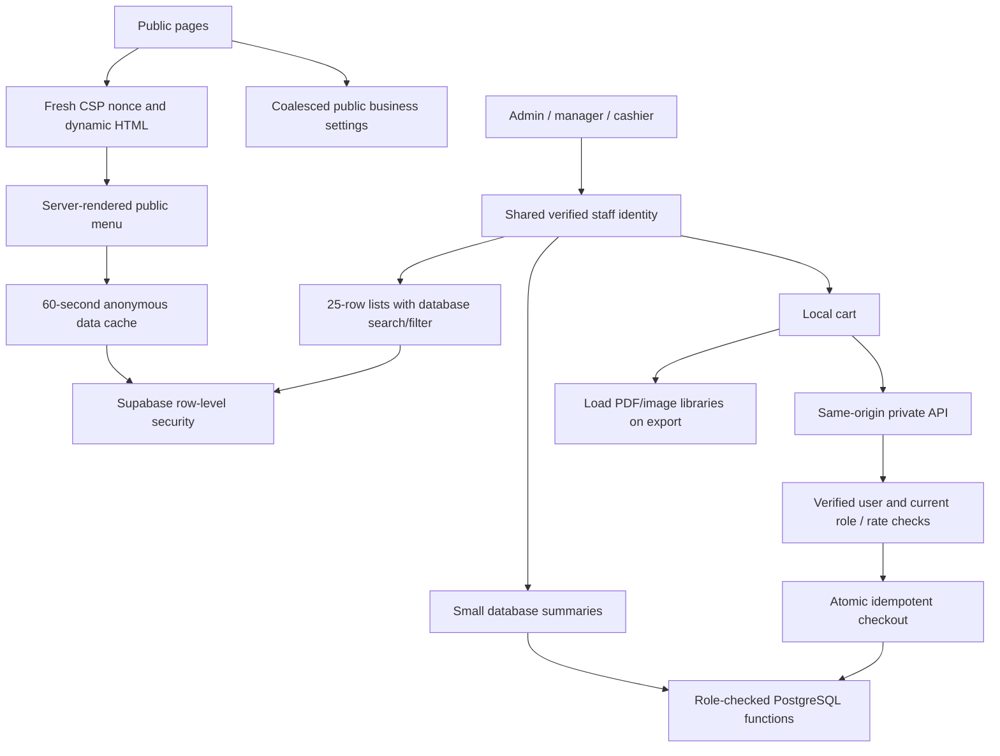

# Architecture and performance review — 13 October 2026

Target: https://thirst-7vos.vercel.app/ and the local production build.

## What caused the stalls

1. The root layout covered every page, including login, with a fixed 2.5-second loading screen and an additional 0.8-second fade. That delay began after hydration. The first live sample left the homepage covered for 5.27 seconds on desktop and 4.88 seconds on a mobile viewport.
2. Every dashboard navigation discarded its current authorization state and waited for `/api/auth/me` again before mounting the page. Billing then requested the same staff identity a second time. The API guard also serialized independent staff and rate-limit database checks.
3. Dashboard, reports, orders and CRM fetched large order/customer collections into the browser. Reports reduced the entire downloaded history, and Supabase's default row limit could silently make totals incomplete above 1,000 records.
4. Public company settings loaded the full Auth SDK and session machinery despite being public data. The homepage and footer issued duplicate settings requests. The live settings endpoint returned 404.
5. The root loaded two Next font families while global CSS separately imported the Poppins/Inter families actually displayed. Several small images used a default full-viewport size. Inventory/gallery thumbnails explicitly bypassed image optimization.
6. Invoice/PDF libraries loaded with billing, orders and CRM, although they are needed only when exporting. Chart libraries were bundled directly into analytics screens. Homepage animations included unused layout/drag features.
7. Checkout kept its busy state while waiting for a separate catalogue refresh after the order was already confirmed. Slow or failed connections could leave general reads/actions waiting indefinitely.
8. Rate limiting deleted expired buckets on every call without an expiry index. The schema lacked indexes matching the frequent chronological/customer lookups.

## Architecture after the changes

The framework, design and existing roles remain. Public pages avoid Auth SDK initialization; menu content is available in the initial server response, with route loading UI while a cold database read completes. Only public menu/business identity is cached. Every private API, RLS query and privileged RPC still checks current access. UI identity persists during navigation and refreshes on focus/sign-in.

Reports and dashboard aggregate in PostgreSQL and return bounded summaries, independent of PostgREST's per-request row cap. A test with 1,505 sales verifies complete totals, Indian-time boundaries, cancelled/future-order exclusion, product totals, and access revocation. CSV details load in 500-row batches only when requested. Orders, customers and franchise applications use 25-row pages; searches run across the database before paging.

Checkout still uses authoritative prices, stock, cashier identity and request IDs. A lost response keeps the exact request for retry. Once confirmation arrives, the cashier can print/start another sale while stock refresh runs independently. The 15-second network deadline changes request waiting only: it does not expire a session or log out an idle administrator. Caller cancellation works on older supported browsers without `AbortSignal.any`.

Fonts are self-hosted, images declare their intended sizes, and valid public-bucket thumbnails use Next image optimization. The small shared stylesheet is inlined to avoid an unstyled streamed layout. Next's `experimental.inlineCss` trades independent CSS caching for approximately 32 KB of uncompressed CSS in HTML; browser/CSP checks cover this setting. Homepage animation features exclude unused layout/drag code. Gallery/review state is isolated so a modal click or slideshow change does not rerender the entire homepage; the slideshow pauses outside the viewport. PDF/image exports and charts load separately.

The contact form previously delayed 800 ms and claimed delivery without sending anything. It now opens an email draft immediately and accurately asks the visitor to send it using their email app; existing WhatsApp contact remains available. The homepage's previously inert location button now links to the existing locations page.

## Measurement scope

`tests/browser-performance.mjs` uses an isolated headless Chrome profile, a cold browser cache, desktop and mobile viewports, and 4× CPU slowdown for mobile. It records navigation/FCP/LCP, sampled layout-shift entries, long tasks, transfer sizes, response failures and basic accessibility. These are individual lab samples, not Lighthouse scores, field INP, p95/p99 API latency, or a production-speed guarantee. Local timing varies with workstation load and server warming.

The pre-change production-build capture is `../performance-local-before.json`; the live capture is `../performance-live-before.json`. No authenticated production accounts or real sales were used.

Latest local production samples (cold browser cache, warm server):

| Measurement | Before | After |
| --- | ---: | ---: |
| Homepage JavaScript transferred | 268,194 B | 194,255 B (28% less) |
| Homepage desktop image transfer | 528,463 B | 247,885 B (53% less) |
| Login image transfer | 59,333 B | 2,521 B (96% less) |
| Homepage desktop LCP | 1.90 s | 0.67 s |
| Homepage mobile LCP, 4× CPU | 2.27 s | 0.83 s |
| Homepage mobile covered by loading overlay | 4.49 s | 0.33 s to first uncovered sample |
| Login mobile covered by loading overlay | 4.13 s | 0.11 s to first uncovered sample |
| Homepage desktop sampled layout-shift sum | 0.211 | 0.00041 |

The global overlay itself is removed, so the final uncovered timings measure document readiness rather than a remaining timed screen. Final raw data is in `../performance-local-final.json`. Initial cold local server samples also reached 2.3 seconds to first byte; three subsequent direct HTML fetches measured 238/112/56 ms to headers. Mobile sampled long-task blocking remains measurable on this workstation, so these results do not establish field INP or production tail latency. Verify those after the real hosting/database rollout.

## Verification

- Production build and TypeScript pass; ESLint has no errors.
- 20 API/database tests pass, including existing security checks and the new public-cache, older-browser cancellation and large-data analytics checks.
- Real browser controls hydrate; CSP blocks injected inline event handlers; anonymous private APIs reject access and return no-store responses; CSP nonces change between requests.
- Browser integration fixtures cover shared staff verification, dashboard navigation, cart preservation during a background connection failure, identical checkout retries, independent stock refresh, lazy PDF download, pagination/search beyond the initial page, selected report totals, revoked access, and cashier/manager route restrictions.
- Public browser interactions verify that gallery images open/close and isolated testimonial controls respond after the animation/state changes.
- The fresh schema and incremental performance migration match. The migration is repeatable and keeps role checks/grants intact.

## Production rollout still required

The local workspace has no live Supabase administrative connection. The live 404 settings response needs the project's table/exposed-schema configuration repaired; suppressing that request would hide the configuration problem.

For an existing database, ensure these migrations are installed in order:

1. `supabase/migrations/20261005_company_settings.sql`
2. `supabase/migrations/20261005_fix_audit_issues.sql`
3. `supabase/migrations/20261013_production_security.sql`
4. `supabase/migrations/20261013_performance.sql`

Install them before deploying this app version, then verify a real admin, manager, cashier and inactive account against the deployed project. Do not rerun the seeded fresh-install schema over an existing production database. Existing sessions keep their refresh behavior; no inactivity timeout was added.

Live response headers showed a Vercel route involving `bom1` and `iad1`. Confirm the Supabase database region and align the function region before changing hosting settings; no database region or hosting credentials are available here. Keep fresh nonce-bearing HTML/private data uncached. Recheck live cold/warm loads and real checkout latency after deployment; those external conditions cannot be validated using fixtures.

Implementation guidance: [Next fetch caching](https://nextjs.org/docs/app/api-reference/functions/fetch), [Motion feature bundles](https://motion.dev/docs/react-reduce-bundle-size), [Supabase indexes](https://supabase.com/docs/guides/database/postgres/indexes), and [LCP measurement](https://web.dev/articles/optimize-lcp).
